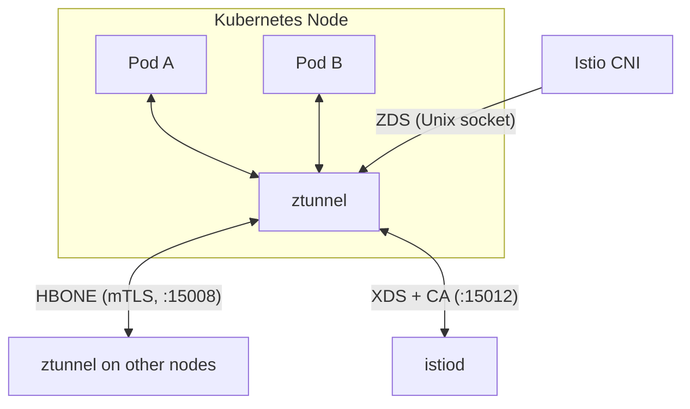

# Architecture

This document gives a high-level overview of how ztunnel is structured. It intentionally avoids low-level detail; the code is the source of truth. See [Development.md](Development.md) for build and test instructions.

## Overview

Ztunnel runs as a DaemonSet that handles ambient mesh traffic for all pods on that node without sidecars. It handles only TCP traffic and DNS. Its main jobs are:

- Securing pod-to-pod TCP traffic with mutual TLS, using the HBONE protocol (HTTP/2 `CONNECT` tunnels over mTLS).
- Enforcing L4 authorization policy.
- Proxying DNS queries from pods.
- Fetching workload, service, and policy configuration from istiod over XDS, and workload certificates from the CA.

## Source layout

| Path | Purpose |
|---|---|
| `src/proxy/` | HBONE data plane: outbound, inbound, inbound passthrough, connection pooling and tracking |
| `src/xds/` | XDS client that receives workloads, services, and authorization policies from istiod |
| `src/state.rs`, `src/state/` | The proxy's view of the mesh (workloads, services, policies) |
| `src/identity/`, `src/tls/` | Workload certificates, CA client, TLS configuration, CRL handling |
| `src/inpod/` | Shared mode: pod network namespace management via the ZDS protocol |
| `src/dns/` | DNS proxy |
| `src/rbac.rs` | Authorization policy evaluation |
| `src/admin.rs`, `src/readiness/`, `src/metrics/` | Admin, readiness, and metrics servers |
| `src/app.rs`, `src/config.rs` | Startup and configuration |

## Runtimes

Ztunnel runs two Tokio runtimes so that control-plane work cannot affect data-plane latency:

- **Main runtime (single-threaded):** the XDS client, certificate management, and the admin and metrics servers.
- **Data-plane worker pool (multi-threaded):** the proxies, the DNS proxy, and the readiness server. The thread count is configurable (see `src/config.rs`).

Shared state is written by the XDS client and read by the data plane.

## Traffic handling

In shared mode (the default), the CNI plugin tells ztunnel about pods joining or leaving the ambient mesh over a Unix domain socket (ZDS), passing each pod's network namespace. Ztunnel then creates the proxy listeners inside that pod's network namespace, so traffic redirection happens within the pod.

### Outbound

1. Traffic from a pod is redirected to the outbound listener (port 15001).
2. Ztunnel looks up the destination in its state. If the destination is in the mesh, it opens (or reuses) an HBONE tunnel to the destination's ztunnel, possibly via a waypoint. Otherwise the traffic is passed through directly.

### Inbound

1. The destination's ztunnel accepts the HBONE connection (port 15008), completes the mTLS handshake, and learns the peer's identity.
2. It evaluates authorization policy and, if allowed, forwards plaintext to the pod. Connections that become unauthorized after a policy update are closed.

Plaintext traffic from non-mesh sources is handled by the inbound passthrough listener (port 15006).

## Identity and TLS

Each workload gets a SPIFFE identity (`spiffe://<trust-domain>/ns/<namespace>/sa/<service-account>`). Ztunnel requests a certificate for each workload from the CA (istiod by default) and rotates it before expiry. TLS is implemented with [rustls](https://github.com/rustls/rustls), with the crypto backend selected at compile time through feature flags (`tls-aws-lc` is the default; see `Cargo.toml`). Certificate revocation is supported through CRLs, which are reloaded dynamically.

## Ports

Ztunnel runs with the following ports:

| Port  | Purpose                                                    | Bound Within Pod Network Namespace |
|-------|------------------------------------------------------------|------------------------------------|
| 15001 | Pod outbound traffic capture                               | Y                                  |
| 15006 | Pod inbound plaintext traffic capture                      | Y                                  |
| 15008 | Pod inbound HBONE traffic capture                          | Y                                  |
| 15080 | Pod outbound `socks5` traffic (experimental, off by default) | Y                                |
| 15053 | Pod outbound DNS traffic capture                           | Y                                  |
| 15021 | Readiness                                                  | N                                  |
| 15000 | Admin (main thread) (Localhost)                            | N                                  |
| 15020 | Metrics (main thread)                                      | N                                  |

The three admin ports (Readiness, Admin, and Metrics) are intentionally split.

* The readiness port runs on the worker pool to ensure we are actually checking the path the data plane handles.
* The admin port must be only on localhost, and it runs on the main thread for isolation.
* The metrics port runs on the main thread for isolation.
  This *could* be on the readiness port, but historically we had found that the stats query can be very expensive and lead to tail latencies in the data plane.

**NOTE** Networking policy must allow inbound and outbound traffic on port 15008 for all application pods, for the ambient mesh to function.
The other ports are not relevant for pod-to-pod communication within the ambient mesh, and are only used for traffic redirection and categorization
within the application pod's network namespace, or for metrics/readiness scraping of the ztunnel pod itself.
See the Istio documentation [Ambient and Kubernetes NetworkPolicy](https://istio.io/latest/docs/ambient/usage/networkpolicy/) for more details.
